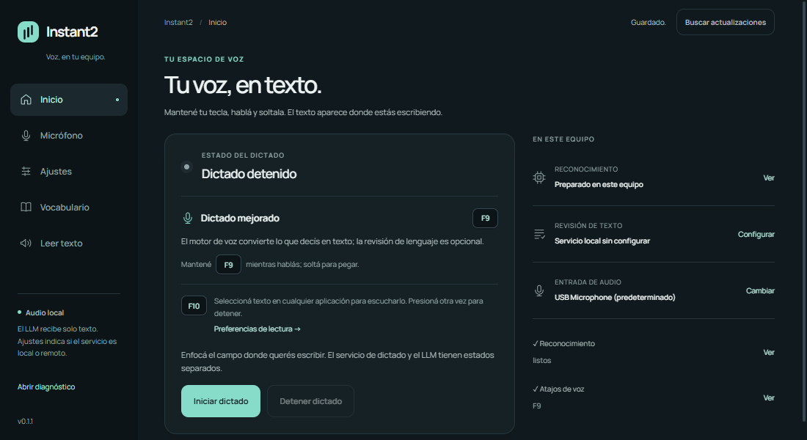
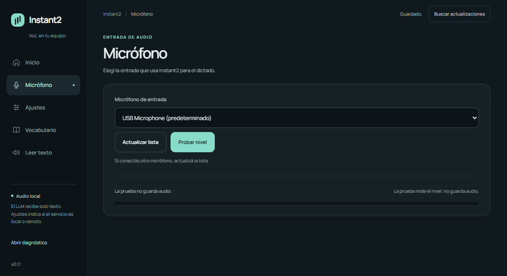
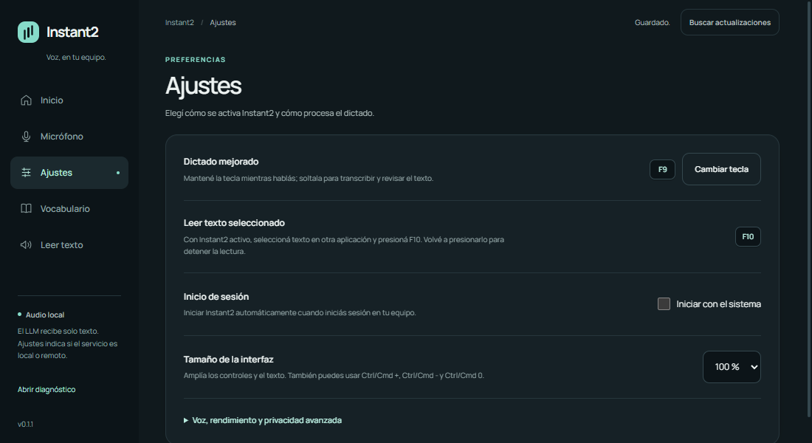
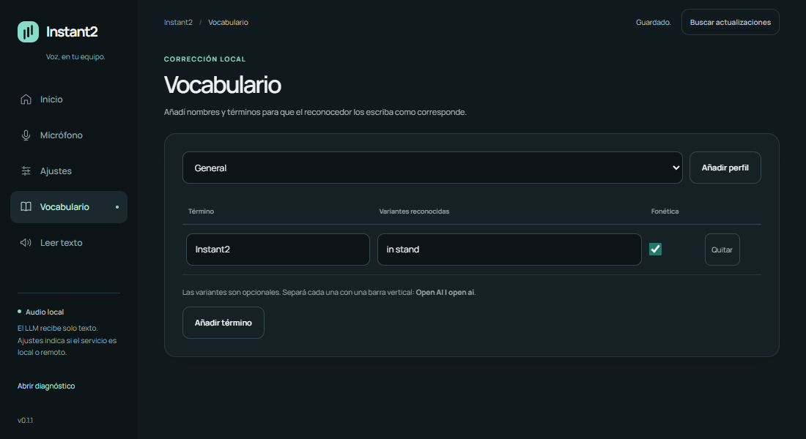
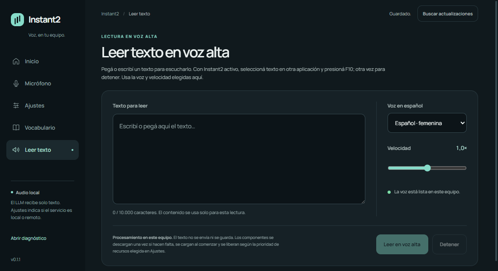
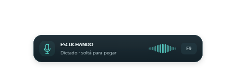

# Instant2 🎙️

**Dictado por voz en español con revisión opcional del texto.** Mantené F9, hablá y soltá: Instant2 escribe en el campo activo. El audio se procesa en este equipo.

[⬇️ Descargar](https://github.com/getodevel-source/Instant2/releases/latest) · [📖 Guía](dictado/README.md) · [📝 Cambios](CHANGELOG.md)

  

## Por qué Instant2

| | |
|---|---|
| 🔒 **Privacidad** | El audio se reconoce en tu equipo. Si conectás un servicio remoto para revisar el texto, solo recibe el texto reconocido. |
| ⚡ **Listo para usar** | El instalador completo de Windows prepara la voz y la revisión de texto para usar sin una descarga inicial. |
| 🎯 **Dictado flexible** | Correcciones de términos, teclas configurables y revisión opcional del texto. |
| 🔊 **Lectura en voz alta** | Escribí o seleccioná texto para escucharlo en español. |

## Empezar

1. Descargá la versión de tu sistema desde [Releases](https://github.com/getodevel-source/Instant2/releases/latest).
2. Abrí Instant2, elegí el micrófono y configurá la tecla de dictado.
3. Enfocá un campo de texto, mantené la tecla mientras hablás y soltala al terminar.
4. Para escuchar texto, abrí **Leer texto** o seleccioná texto y presioná **F10**.

En el portable y en Linux/macOS, Instant2 descarga los componentes de voz durante el primer uso. Necesitás internet y cerca de 1 GB libre. El instalador completo de Windows los incluye y puede instalarse sin conexión si mantenés juntos el ejecutable y todos sus archivos `.bin`.

| Sistema | Descarga |
|---|---|
| Windows | `Instant2-Setup.exe` (instalador) o `Instant2.exe` (portable) |
| Linux (X11; Wayland/Hyprland experimental) | `instant2-linux` |
| macOS | `instant2-macos` |

Los assets incluyen un archivo `.sha256` para verificar la descarga. Antes de dictar, aceptá el permiso del micrófono. En macOS autorizá también **Accesibilidad** para permitir el pegado. Los binarios actuales no tienen firma de sistema operativo; Windows y macOS pueden mostrar un aviso la primera vez.

## Pantallas

<table>
  <tr>
    <th>Micrófono</th>
    <th>Ajustes</th>
  </tr>
  <tr>
    <td></td>
    <td></td>
  </tr>
  <tr>
    <th>Vocabulario</th>
    <th>Lectura en voz alta</th>
  </tr>
  <tr>
    <td></td>
    <td></td>
  </tr>
  <tr>
    <th>Dictado activo</th>
    <th>Aviso</th>
  </tr>
  <tr>
    <td></td>
    <td></td>
  </tr>
  <tr>
    <th colspan="2">Estado listo</th>
  </tr>
  <tr>
    <td colspan="2" align="center"></td>
  </tr>
</table>

## Privacidad y actualizaciones

El audio no se envía a la nube. La revisión opcional puede usar un servicio local o remoto; si elegís uno remoto, recibe texto, nunca audio. Instant2 no guarda audio ni transcripciones en sus registros por defecto.

En **Ajustes → Actualizaciones**, podés recibir un aviso antes de descargar, permitir la descarga automática en segundo plano o apagar las consultas. Cada descarga se verifica antes de instalarse. Instant2 te pide confirmar la instalación y el reinicio para que puedas terminar lo que estás haciendo.

## Más información

[Instalación y uso detallados](dictado/README.md) · [Precisión y motores](docs/precision.md) · [Historial de versiones](CHANGELOG.md) · [Licencia MIT](LICENSE)
