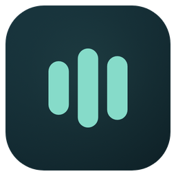

# Marca Instant2

<p align="center">
  
</p>

**Instant2 convierte la voz en texto, en el campo donde ya estás escribiendo.**
La marca se siente como la herramienta: inmediata, silenciosa, precisa y privada.
Todo lo visual parte de una idea simple: **una señal que se vuelve texto**.

| | |
|---|---|
| **Promesa** | Tu voz, en texto. |
| **Descriptor** | Dictado por voz, en tu equipo. |
| **Personalidad** | Precisa, tranquila, cercana. Sin épica ni tecnicismos. |
| **No es** | Un asistente que habla, una nube, un chatbot, una app de productividad ruidosa. |
| **Territorio** | La señal de voz y el cursor de texto. Petróleo profundo y verde agua. |

---

## 1. Nombre y voz

- **Instant2**, siempre junto: mayúscula inicial, sin espacio y con el `2` pegado.
  Nunca *Instant 2*, *instant2* ni *I2* en texto corrido.
- `instant2` en minúsculas solo para identificadores: slug, comando, paquete,
  nombre de archivo.
- La `2` no se escribe como superíndice (`Instant²`).
- Voz en **español rioplatense con voseo** (`mantené`, `soltá`, `elegí`),
  frases cortas, oración por línea, sin signos de exclamación.
- Se habla de **tu voz**, **tu equipo** y **lo que estás escribiendo**; no de
  "el usuario" ni de "la solución".
- Los estados van en presente y sin adornos: *Dictado detenido*, *Escuchando*,
  *Preparando el texto*.
- Un error dice qué pasó y qué hacer a continuación. Nunca culpa a la persona.

| En vez de | Escribí |
|---|---|
| ¡Empezá a dictar ya! | Mantené F9, hablá y soltá. |
| El usuario debe configurar el micrófono. | Elegí el micrófono en **Micrófono**. |
| Error inesperado. | No pude acceder al micrófono. Revisá el permiso en Windows. |
| Potenciá tu productividad con IA. | Escribí hablando, sin salir del campo. |

El nombre del producto no se traduce. Los nombres de las vistas tampoco:
**Inicio**, **Micrófono**, **Ajustes**, **Vocabulario**, **Leer texto**.

---

## 2. El símbolo: la señal

El símbolo son **tres barras verticales con extremos redondeados**. No es un
ecualizador decorativo: es un instante congelado del indicador de voz de la app.

- La barra **central** es la voz.
- La **izquierda** es la entrada; la **derecha**, el texto que sale.
- La derecha es más alta que la izquierda: la señal **avanza**.
- La altura distinta evita el aire de "pausa" o de tres barras genéricas y
  mantiene la lectura de onda a 16 px.

### Construcción

Caja de referencia: **100 × 100**. Las barras se centran verticalmente.

| Barra | x | Alto | Centro vertical |
|---|---:|---:|---:|
| Izquierda | 19 | 42 | 50 |
| Central | 42 | 62 | 50 |
| Derecha | 65 | 50 | 50 |

| Propiedad | Valor |
|---|---:|
| Ancho de barra | 16 |
| Separación entre barras | 7 |
| Radio de extremo | 8 (media barra) |
| Caja ajustada del símbolo | 62 × 62 |
| Área libre mínima | 16 (un ancho de barra) |

Proporciones clave: la barra mide **26 %** de la caja ajustada y la barra
central ocupa el **100 %** de la altura del símbolo. Con esa relación el icono
sigue leyéndose a 16 px sin agregar ni quitar elementos.

**No se rediseña por tamaño.** No hay versión de dos barras, no se cambian las
alturas, no se separan más las barras ni se les agrega contorno.

---

## 3. Logotipo y lockups

El logotipo es **Manrope 700** con tracking **−0,035 em**, convertido a curvas.
No se escribe con la fuente instalada: los SVG llevan los trazados, así que se
ven igual en cualquier equipo.

| Pieza | Composición | Uso |
|---|---|---|
| **Símbolo** | Tres barras; ajustado a 62 × 62 | Avatar, favicon, marca de agua |
| **Logotipo** | `Instant2` en curvas | Cuando el símbolo ya aparece cerca |
| **Lockup horizontal** | Símbolo 130 + separación 46 + logotipo (alto de mayúscula 100) | **Principal**: README, web, presentaciones |
| **Lockup apilado** | Símbolo 128 + separación 40 + logotipo centrado | Formatos cuadrados o estrechos |
| **Icono de app** | Squircle petróleo + símbolo | Sistema operativo, instalador, tienda |

### Área libre y tamaños mínimos

- Área libre: **un ancho de barra** (16 unidades) alrededor de todo el lockup.
  Nada de texto, bordes ni imágenes dentro de ese margen.
- Símbolo: mínimo **16 px**.
- Lockup horizontal: mínimo **120 px** de ancho.
- Lockup apilado: mínimo **72 px** de ancho.
- Por debajo del mínimo, usar solo el símbolo.

### Variantes

| Fondo | Símbolo | Logotipo | Archivo |
|---|---|---|---|
| Oscuro (petróleo) | Verde agua `#86dbc9` | Niebla `#edf3f2` | `brand/logo/instant2-lockup-horizontal-on-dark.svg` |
| Claro | Tinta `#0c1418` | Tinta `#0c1418` | `brand/logo/instant2-lockup-horizontal-on-light.svg` |
| Una tinta | Blanco | Blanco | `brand/logo/instant2-mark-white.svg` |

El logotipo es **monocromo**. El color lo aporta el símbolo. No se colorea la
`2`, no se aplican degradados al texto y no se agregan sombras.

### Lo que no se hace

- Estirar, rotar, inclinar o comprimir el lockup.
- Cambiar el orden o las alturas de las barras.
- Poner el símbolo dentro de un círculo, un cuadrado extra o un badge.
- Usar verde agua sobre fondo claro: el contraste es **1,6:1**.
- Recrear el logotipo escribiendo "Instant2" con otra fuente o peso.
- Animar el logo estático.

---

## 4. Color

La fuente de verdad es `dictado/src/instant2_app/branding.py`
(`PALETTE`). La web del panel y del indicador inyectan esos tokens; no se
escriben colores a mano en las páginas.

### Núcleo

| Token | Hex | Rol |
|---|---|---|
| `bg_alt` / **Petróleo 950** | `#0c1418` | Fondo más profundo, tinta del logo claro |
| `panel_background` / **Petróleo 900** | `#10191d` | Fondo del panel |
| `panel_surface` / **Petróleo 800** | `#162126` | Superficies y tarjetas |
| `panel_surface_high` / **Petróleo 700** | `#223238` | Superficies elevadas |
| `panel_line` | `#34474e` | Bordes de 1 px |
| `panel_accent` / **Verde agua** | `#86dbc9` | **Marca**: símbolo, foco, señal |
| `panel_accent_soft` | `#b8ebde` | Texto sobre superficies de marca |
| `panel_accent_button` | `#24796b` | Acciones primarias |
| `panel_text` / **Niebla** | `#edf3f2` | Texto principal |
| `panel_muted` | `#b0bfbe` | Texto secundario |
| `panel_faint` | `#91a4a5` | Metadatos y ayudas |
| `green` | `#7cdda6` | Éxito |
| `amber` | `#f2c36a` | Aviso |
| `red` | `#ff908b` | Error |
| `working` | `#8fd7e8` | Procesando |
| `icon_bg_start` → `icon_bg_end` | `#17333c` → `#0f2228` | Fondo del icono de app |

El indicador usa además `accent` (`#55d5c8`) como señal viva. No es un segundo
verde de marca: es el mismo rol con más luminosidad sobre vidrio.

### Contraste comprobado

| Combinación | Ratio | Uso |
|---|---:|---|
| Verde agua sobre Petróleo 900 | 11,0:1 | Símbolo y texto de marca |
| Niebla sobre Petróleo 900 | 15,9:1 | Texto principal |
| Tenue (`faint`) sobre Petróleo 900 | 6,8:1 | Ayudas y metadatos |
| Tinta sobre Verde agua | 11,5:1 | Símbolo en el chip de la app |
| Verde agua sobre blanco | **1,6:1** | **Prohibido** |

El color nunca es la única señal: los estados suman icono y texto.

---

## 5. Tipografía

**Manrope** variable (200–800), licencia SIL OFL, incluida localmente en
`dictado/src/instant2_app/web/Manrope.ttf`. No se descarga nada al abrir la app.

| Rol | Peso | Tamaño | Tracking |
|---|---:|---:|---:|
| Titular de pantalla | 550 | 32 px | −0,055 em |
| Título de sección | 650 | 15 px | −0,025 em |
| Texto | 450–550 | 11–13 px | 0 |
| Etiqueta superior (*eyebrow*) | 650 | 9–10 px, mayúsculas | +0,16 em |
| Contador / clave (F9) | 600–700 | 10 px | 0 |
| **Logotipo** | 700 | curvas | −0,035 em |

Reglas:

- Interlineado ajustado en titulares (1,02–1,22); 1,45 en párrafos.
- Los números de atajos (F9, F10) van en mayúscula y con `kbd` de la app.
- La bastardilla no se usa en la interfaz.
- Si Manrope no carga, el respaldo es `Segoe UI`; nunca una serif.

---

## 6. Forma y composición

La interfaz y la marca comparten una geometría de **rectángulos redondeados**.

| Elemento | Radio |
|---|---:|
| Tecla / `kbd` | 7 px |
| Control, navegación, chip de marca | 10 px |
| Tarjeta / modal | 14–18 px |
| Indicador de voz (píldora 344 × 56) | 28 px |
| Icono de app (960 sobre 1024) | 224 px (23 %) |

- Superficies planas, borde de 1 px y como mucho una sombra suave.
- El **vidrio** se reserva para el indicador flotante; no para tarjetas.
- Iconos de trazo fino (1,5–2 px), extremos redondeados, 20 px.
- Escala de espacio: 4, 8, 12, 16, 24, 32.
- La píldora del indicador es la firma física del producto: mismo lenguaje que
  el icono y las barras. No se reemplaza por un círculo ni por una caja.

---

## 7. Movimiento

El logo **no se anima**. La única marca viva es el indicador de dictado, porque
ahí el movimiento informa: sigue la voz real.

| Cambio | Respuesta | Tiempo |
|---|---|---:|
| Entrada del indicador | Opacidad, escala 0,99 → 1, 3 px | 180 ms |
| Salida | Opacidad y 3 px | 130 ms |
| Ataque / caída de la señal | Interpolación de barras reales | 45 / 120 ms |
| Cambio de estado | Asentamiento del icono, sin rebote | 120 ms |

Con `prefers-reduced-motion`, la señal queda estática y el logo no cambia.
El detalle de implementación está en
[`docs/diseno-ui-y-animaciones.md`](docs/diseno-ui-y-animaciones.md).

---

## 8. Aplicaciones

| Soporte | Archivo | Regla |
|---|---|---|
| Icono de app | `brand/png/app-icon-{16…1024}.png`, `brand/ico/instant2.ico` | Squircle completo; no recortar ni agregar fondo |
| Instalador y `.exe` | `dictado/build/instant2.ico` | Lo genera `dictado/build_icon.py` con el mismo dibujo que `brand/ico` |
| Bandeja del sistema | Generado en runtime con `create_icon_image()` | Mismo icono, sin variante monocroma |
| Chip del panel | `panel.html` (`.brand-mark`) | Símbolo en tinta sobre verde agua, 29 px |
| Favicon | `brand/png/favicon-32.png` | 32 px, mismo icono |
| README / GitHub | Lockup horizontal, variantes oscura y clara | `<picture>` según el tema |
| Imagen social | `brand/social/og-image.png` (1200 × 630) | Lockup + promesa + píldora del indicador |
| Avatar / tienda | `brand/png/app-icon-512.png` | Sin texto |

### Icono de app

- Lienzo **1024 × 1024**; squircle de **960** con margen **32** y radio **224**.
- Degradado diagonal `#17333c` → `#0f2228` y un halo verde agua al 9 % detrás
  del símbolo.
- Símbolo de **460 px** de lado, centrado (48 % del squircle).
- A 16 px se usa el mismo dibujo: no hay una versión "simplificada" que cambie
  la marca.
- El `.ico` y la bandeja se generan con `create_icon_image()`; ahí el degradado
  se sustituye por su tono medio plano (`#132a32`), que es lo único que se
  distingue por debajo de 32 px. El PNG de 1024 conserva el degradado.
- No se apoya el icono sobre fotos sin una placa de petróleo detrás.

---

## 9. Archivos

```text
design.md                      ← este documento
brand/
├── logo/                      ← SVG maestros, texto en curvas
│   ├── instant2-mark.svg              símbolo verde agua (fondos oscuros)
│   ├── instant2-mark-ink.svg          símbolo tinta (fondos claros)
│   ├── instant2-mark-white.svg        una tinta
│   ├── instant2-app-icon.svg          icono 1024
│   ├── instant2-wordmark-on-dark.svg
│   ├── instant2-wordmark-on-light.svg
│   ├── instant2-lockup-horizontal-on-dark.svg
│   ├── instant2-lockup-horizontal-on-light.svg
│   └── instant2-lockup-stacked-on-dark.svg
├── png/                       ← exportaciones rasterizadas
├── ico/instant2.ico           ← Windows 16–256
├── social/og-image.png        ← 1200 × 630
└── tools/build_brand.py       ← genera todo desde branding.py
```

Los SVG son la fuente; los PNG y el ICO se regeneran. No se editan a mano.
El tablero visual está en [`brand/sheet.html`](brand/sheet.html): se abre en el
navegador y reúne símbolo, lockups, color, tipografía y aplicaciones.

```bash
python brand/tools/build_brand.py          # SVG + PNG + ICO + OG
python brand/tools/build_brand.py --svg    # solo vectores
python brand/tools/build_brand.py --png    # solo rasterizado
```

Requiere Pillow, fontTools y Chrome o Edge (para rasterizar). La geometría del
símbolo y la paleta viven en `branding.py`; el script las importa para que el
icono de la bandeja, el del instalador y los assets no se separen nunca.

---

## 10. Lista rápida

Antes de publicar una pieza:

- [ ] ¿Dice **Instant2**, junto y con mayúscula inicial?
- [ ] ¿El símbolo tiene las tres barras en el orden y las alturas correctas?
- [ ] ¿Hay al menos un ancho de barra libre alrededor?
- [ ] ¿Verde agua solo sobre fondo oscuro?
- [ ] ¿El logotipo es el trazado, no texto con una fuente?
- [ ] ¿Se respetó el tamaño mínimo (16 / 120 / 72 px)?
- [ ] ¿El texto usa Manrope y la voz de la marca?
- [ ] ¿La pieza funciona en tema claro y oscuro?
- [ ] ¿El movimiento es del indicador, no del logo?
- [ ] ¿Los assets salieron del script y no de una copia manual?

---

## 11. Decisiones y pendientes

- El icono de la app deja el micrófono y adopta la **señal de tres barras** para
  coincidir con el chip del panel y el indicador. El micrófono sigue siendo un
  icono funcional dentro de la interfaz, no la marca.
- El símbolo se dibuja en runtime con Pillow para la bandeja y la ventana; el
  SVG es la referencia visual. Cambiar `MARK_BARS` actualiza ambos.
- Pendiente: búsqueda de antecedentes marcarios de "Instant2" antes de un
  lanzamiento comercial.
- Pendiente: regenerar las capturas de `docs/screenshots/` para que muestren el
  chip con la nueva señal.
- Pendiente: revisar el ICO en Windows a 100, 125, 150 y 200 % de escala y en
  barra de tareas clara y oscura.
