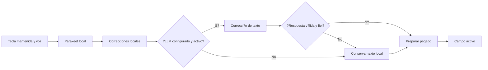

# Flujo de dictado de Instant2

**Estado:** aplicaci?n independiente con dictado mejorado y correcci?n LLM opcional.

## Objetivo

Instant2 convierte voz en texto con rapidez, conserva los datos dictados y entrega el resultado en el campo activo. El audio se reconoce localmente con Parakeet. Las correcciones locales y el LLM de texto pueden mejorar el resultado sin volver obligatorio el servicio de lenguaje.

## Flujo de una sesi?n

1. La persona enfoca un campo y mantiene la tecla configurable, F9 por defecto.
2. Instant2 captura el audio sin mostrarlo ni guardarlo en sus registros.
3. Al soltar la tecla, Parakeet transcribe el audio localmente.
4. Instant2 aplica sus correcciones locales y, si est? activada, env?a el texto al LLM configurado.
5. El LLM revisa ortograf?a, puntuaci?n y errores claros del reconocimiento. Una comprobaci?n adicional reduce cambios que puedan alterar las palabras o el sentido.
6. Instant2 pega el resultado. Si el servidor no responde o la propuesta no pasa la comprobaci?n, usa el texto corregido localmente.

## Comportamiento del servicio

- La conexi?n usa el endpoint compatible con OpenAI configurado en Ajustes.
- El LLM recibe texto, no audio. La app muestra si el endpoint es local o remoto.
- Si el servicio est? apagado, no responde o falla la validaci?n de la propuesta, el texto corregido localmente sigue disponible.
- El servidor no es requisito para iniciar una sesi?n de dictado.
- El texto dictado no se guarda en registros ni historial por defecto.
- El instalador no incluye ni descarga modelos de lenguaje: los componentes de voz (ASR, TTS y el LLM local opcional) los descarga la app al directorio de datos del usuario. El modelo ASR existente se administra por separado.
- El reconocimiento (~670 MB) se baja solo la primera vez que se abre el panel sin los modelos; una vez por instalación, para no competir con el botón «Reintentar descarga». El modelo de lenguaje local (3 GB) es una descarga explícita desde Ajustes.

## Preparación de los modelos

El instalador de Windows ya no lleva los pesos: instala la app y el runtime de
llama.cpp. Los modelos llegan a la máquina por tres caminos distintos:

1. **Del producto anterior**: al resolver el directorio de datos, la app mueve
   los modelos que ya estaban en el directorio de Instant (`%LOCALAPPDATA%/
   instant/models`) al suyo. Es un rename, no una copia, y si ambos directorios
   existen se fusionan sin dejar duplicados.
2. **Del reconocimiento**: la primera vez que se abre el panel sin Parakeet ni
   el VAD, el panel arranca la descarga sola (670 MB), con progreso,
   cancelación y verificación por hash. Si la persona la cancela o falla, el
   botón «Reintentar descarga» queda a su cargo.
3. **Del modelo de lenguaje**: 3 GB no se bajan sin permiso. En Ajustes →
   Revisión del dictado y privacidad → Archivos del servicio local, el botón
   «Descargar modelo (3 GB)» hace la descarga, con su progreso y su
   cancelación.

Mientras el reconocimiento no está, el dictado no arranca (el aviso lo dice);
el resto de la app sigue funcionando, incluida la lectura de texto.

## Entrega y foco

El overlay no toma el foco durante la grabaci?n. Instant2 conserva la ventana donde comenz? la sesi?n y usa el pegado habitual. La indicaci?n de ?xito significa que envi? el atajo de pegado; la aplicaci?n no puede verificar universalmente que el campo receptor lo acept?. En Wayland/Omarchy, el registro del atajo y el pegado dependen del compositor y requieren validaci?n manual.

## LLM local y rendimiento

Instant2 reutiliza la configuraci?n OpenAI compatible. Puede administrar un `llama-server` local ya instalado y mantener el modelo residente mientras la aplicaci?n est? abierta. El instalador de Windows incluye un `llama-server` Vulkan con respaldo a CPU; el modelo Qwen 4B local (3 GB) se descarga a pedido desde Ajustes, con su progreso y su cancelación; el portable y los paquetes de otros sistemas permiten conectar un servidor ya instalado. Si falla la aceleraci?n disponible, el supervisor puede intentar CPU de acuerdo con los recursos detectados y comunicar el estado real.

La evaluaci?n del modelo debe separar errores del ASR, cambios del LLM, tiempo de carga en fr?o, latencia caliente y consumo de memoria. Los resultados sint?ticos disponibles son orientativos y provienen de una sola m?quina.

## Validaci?n manual pendiente

- Windows: captura con el micr?fono real, revisi?n del LLM local y remoto, fallo del servidor, atajo y pegado en varias aplicaciones.
- Wayland/Omarchy: atajo global del portal, overlay sin foco y pegado en aplicaciones nativas y XWayland.
- Recursos: arranque en fr?o, latencia caliente y memoria en un equipo CPU y otro con GPU.
