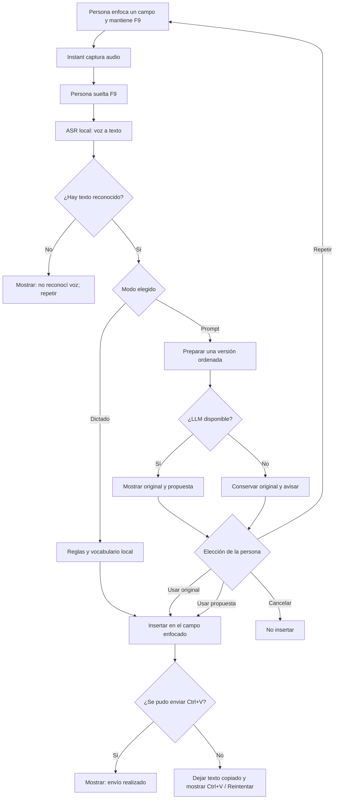
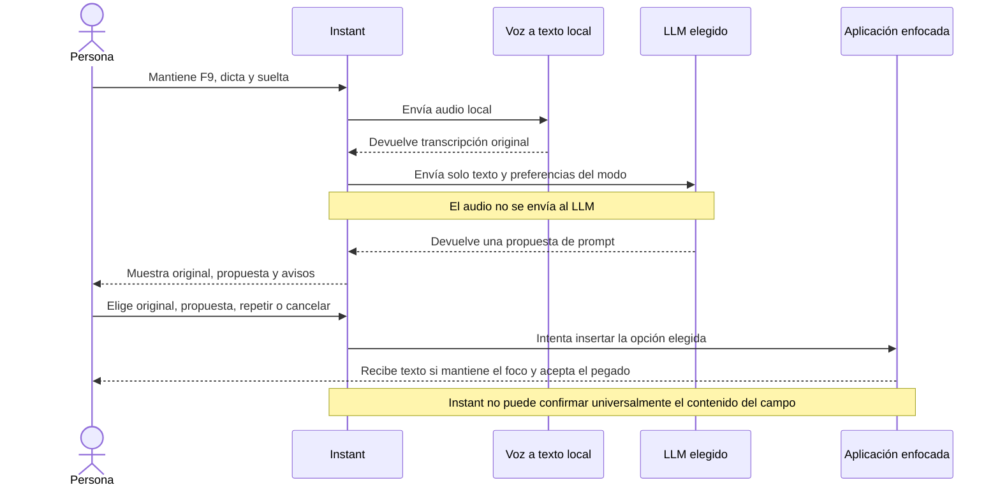
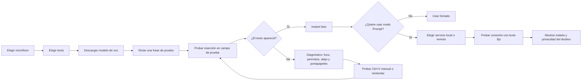
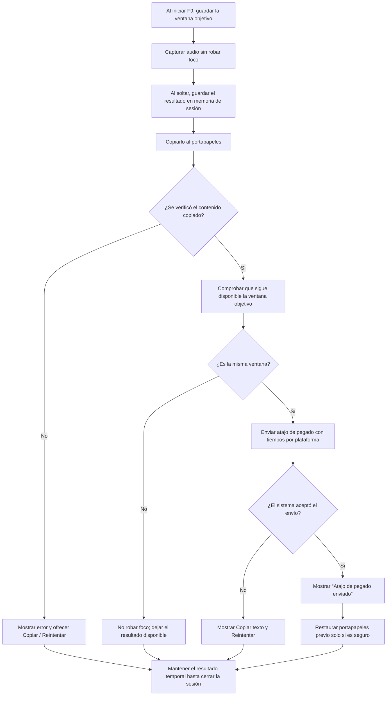
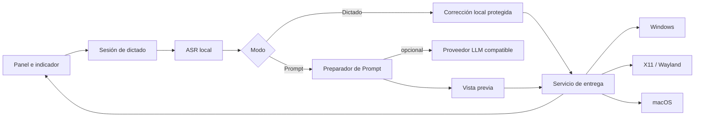

# Plan de Instant2: dictado confiable y modo Prompt

**Estado:** propuesta de producto y diseño; todavía no implementada.

**Base:** Instant `v0.5.2`.

**Prioridad principal:** que el texto dictado llegue de forma visible al campo correcto. Después, sumar un modo opcional que convierta lo dicho en un prompt mejor organizado.

## En una frase

Instant2 debe conservar el dictado directo como camino rápido y sumar un modo separado, **Prompt**, para ordenar lo que la persona dicta como instrucción para otra IA. El modo Prompt muestra el original y la propuesta antes de insertarla. Instant prepara texto: no ejecuta acciones en la aplicación destino.

## Qué tenemos hoy

| Parte | Estado en `v0.5.2` | Implicación para Instant2 |
|---|---|---|
| Voz a texto | Reconocimiento local con Parakeet y reglas/vocabulario de Instant. | Mantenerlo como camino por defecto; un LLM de texto no reemplaza al reconocedor de voz. |
| Pulido con LLM | Endpoint opcional compatible con OpenAI. Si se configura, corrige texto dudoso; conserva el resultado local si el servicio falla o intenta cambiar las palabras. | El modo Prompt necesita una etapa separada: allí sí se permite reorganizar la frase, con revisión humana. |
| Entrega | Instant prepara el portapapeles y envía `Ctrl+V` en Windows. En otros sistemas usa el mecanismo propio de cada escritorio. | La llamada de pegado puede terminar sin que Instant sepa si el campo de la aplicación aceptó el texto. Hay que mostrar estados precisos y recuperación visible. |
| Incidente comunicado | En Windows, dentro del navegador, el dictado queda disponible: al pulsar `Ctrl+V` manualmente aparece. | Esto apunta a revisar el envío automático de teclas, el foco y los tiempos. No confirma por sí solo la causa exacta. |

La versión `v0.5.2` ya espacia la secuencia de teclas de Windows y espera antes de restaurar el portapapeles. Aun así, el proceso no lee el contenido del navegador para confirmar que se insertó. La validación en una sesión real sigue pendiente.

## La experiencia propuesta

### Modo Dictado

Es el modo inicial y conserva el hábito actual: mantener la tecla, hablar y soltar. Instant reconoce la voz, aplica las reglas locales y entrega el texto al campo enfocado. No agrega espera de LLM si el servicio opcional no hace falta.

### Modo Prompt

La persona dicta la idea o pedido que quiere enviar a una IA. Instant mantiene la transcripción original, genera una versión ordenada y muestra ambas para revisar. La versión ordenada puede cambiar la estructura y la redacción, así que el guard de palabras del modo Dictado no aplica aquí; la vista previa es el control de precisión.

**Ajuste inicial recomendado:** confirmar antes de insertar en modo Prompt. Cuando la persona confíe en los resultados, puede activar la inserción directa desde Preferencias. El modo Dictado siempre conserva la entrega directa.

### Cuadro de estados del indicador

```text
┌──────────────────────────────────┐
│ Instant · Dictado                 │
│ ● Escuchando                      │
│ Mantené F9 y hablá                │
└──────────────────────────────────┘

┌──────────────────────────────────┐
│ Instant · Prompt                  │
│ ◌ Preparando tu prompt…           │
│ Soltaste F9 · todavía no inserté  │
└──────────────────────────────────┘

┌──────────────────────────────────┐
│ Texto enviado al campo            │
│ Si no aparece, usá Copiar texto   │
│ y después probá Ctrl+V            │
└──────────────────────────────────┘
```

El indicador debe decir qué hizo Instant, sin asegurar que la aplicación destino aceptó el texto cuando no puede comprobarlo.

## Flujo gráfico: desde la tecla hasta el texto



## Flujo gráfico: revisar y aceptar un Prompt



### Vista previa sugerida

```text
┌──────────────────────── Instant · revisar prompt ─────────────────────┐
│ Lo que dijiste                                                        │
│ “compará estas opciones y decime cual conviene para mi caso”          │
│                                                                       │
│ Propuesta                                                             │
│ “Compará las opciones disponibles y recomendá cuál conviene para mi   │
│ caso. Explicá los criterios que usaste.”                              │
│                                                                       │
│ [Usar original] [Insertar propuesta] [Repetir] [Cancelar]             │
└───────────────────────────────────────────────────────────────────────┘
```

La propuesta es solo ilustrativa. El modelo no debe agregar criterios, datos o restricciones que la persona no dijo. Si la intención queda ambigua, debe conservar la ambigüedad y marcarla para revisión en vez de inventar una respuesta.

## Flujo gráfico: primera configuración



El setup del LLM no debe retrasar el primer dictado. Dictado queda disponible sin servidor de lenguaje.

## Flujo de entrega confiable



**Regla de foco y recuperación:** registrar temporalmente qué ventana estaba activa al comenzar F9. El indicador no debe tomar el foco. En Prompt, al aceptar, intentar volver solo a esa ventana si sigue disponible; si cambió o no se puede identificar, no robar foco. Mantener el resultado en memoria temporal para que **Copiar texto** lo ponga otra vez en el portapapeles. Restaurar el portapapeles previo solo cuando la salida siga recuperable y el margen de pegado por plataforma haya terminado.

**Regla de interfaz:** “atajo de pegado enviado” significa que Instant envió la combinación de teclas; no que haya leído el campo de la aplicación y comprobado su contenido. Si el pegado no se puede verificar, la salida debe permanecer recuperable desde el portapapeles o desde el botón Copiar.

## Organización técnica sugerida



Separar el preparador de Prompt del corrector actual evita debilitar su protección de palabras. El proveedor de lenguaje recibe texto solamente; el motor ASR continúa siendo el único que recibe audio.

## Diseño del modo Prompt y del LLM

- Usar el endpoint compatible ya disponible como primer adaptador. Evaluar Ollama o `llama.cpp` sin obligar a instalar uno ni empaquetar modelos con Instant.
- Permitir **Sin LLM**, **Local** y, si la persona lo configura, **Remoto**. Identificar claramente el destino: un servicio remoto recibe texto y debe tener una advertencia explícita.
- La prueba de conexión usa una frase fija, nunca un dictado real. Mostrar conexión, modelo informado y latencia aproximada.
- En Prompt, enviar la transcripción y las preferencias necesarias; nunca el audio. No guardar transcripciones ni prompts por defecto.
- Mantener una versión original recuperable. Si el servicio falla, ofrecer “Usar original”, “Reintentar” o “Cancelar”; no presentar la transcripción como si hubiera sido mejorada.
- Ajustar el prompt del sistema a: conservar intención, entidades, cifras, restricciones y tono; mejorar orden y claridad; no inventar datos; devolver solo el texto, con avisos aparte si la interfaz los soporta.
- Mantener el LLM apagado por defecto hasta medir calidad, demora, memoria y uso real del modo.
- La selección de modelos se decide con la comparación del [informe de tecnología y LLM local](informe-tecnologia-y-llm-local.md), no por una demostración aislada. Sus tamaños son de descarga y no equivalen a la RAM usada al ejecutarlos.

## Ruta de implementación recomendada

| Orden | Entrega | Motivo | Criterio para avanzar |
|---|---|---|---|
| **P0** | Diagnosticar la inserción automática en Windows y navegadores. Capturar la ventana objetivo al iniciar F9 y diferenciar transcripción, portapapeles, foco y envío de teclas. | Es el problema que hoy corta el recorrido principal. | Una matriz manual en las aplicaciones de navegador y campos comunes registra si el texto llegó, si quedó disponible para copiar, qué aplicación tenía el foco y qué recuperación funcionó. No declarar resuelto por el solo hecho de que el proceso de pegado no lanzó error. |
| **P1** | Estados del overlay: escuchando, transcribiendo, preparando Prompt, vista previa, pegado enviado, copiado para pegar y error. | Reduce la duda sobre dónde quedó el texto. | Cada resultado muestra una acción clara; los errores conservan el texto para recuperarlo. |
| **P2** | Añadir el modo Prompt con original/propuesta y confirmación antes de insertar. | Introduce la nueva capacidad sin cambiar el significado a escondidas. | El modo no ejecuta acciones, la vista previa siempre conserva el original y cancelar no escribe nada. |
| **P3** | Configuración del endpoint: destino local/remoto, prueba inocua, estado del modelo y opción de inserción directa. | Hace viable el uso cotidiano sin descargar modelos a la fuerza. | La prueba no transmite datos personales; desconectar el servidor no rompe Dictado. |
| **P4** | Evaluación del LLM y refinamiento de interfaz/accesibilidad. | Evita elegir por intuición y detecta regresiones. | Medir conservación de intención, cambios no solicitados, latencia, RAM y satisfacción con muestra revisada; mantener la evaluación del ASR por separado. |

## Criterios de calidad y privacidad

- **Fidelidad:** Dictado sigue siendo una transcripción directa y no depende del LLM. Comparar sus errores de voz con el baseline de Instant, sin mezclar la reescritura de Prompt.
- **Intención:** en Prompt se evalúan omisiones, agregados inventados, cambios de cifras/nombres/restricciones y utilidad del resultado. La vista previa es obligatoria en el primer recorrido.
- **Entrega:** medir por separado “texto reconocido”, “texto copiado”, “atajo enviado” y “texto visible en el destino” durante la validación manual.
- **Rendimiento:** informar mediana y p95 de latencia, carga en frío, RAM durante uso y consumo en reposo; medir ASR y LLM como procesos separados.
- **Recuperación:** errores de servidor, foco o pegado no borran la única copia del resultado ni cierran el recorrido sin explicación.
- **Privacidad:** no guardar audio, transcripciones ni prompts por defecto. Los datos privados de evaluación requieren consentimiento y quedan fuera de Git/CI.
- **Sin acciones automáticas:** Instant solo redacta y pega texto. No envía, confirma, pulsa botones ni ejecuta órdenes en la aplicación receptora.

## Documentos relacionados

- [Informe de tecnología y LLM local](informe-tecnologia-y-llm-local.md): candidatos, límites, medición y recomendación de modelos.
- [Informe de mejoras](informe-mejoras.md): mejoras de producto y rendimiento que ya se habían propuesto.
- [Precisión del dictado](precision.md): evidencia y límites del reconocimiento de voz.
- [Validación de release](validacion-release.md): comprobaciones de las compilaciones publicadas.
